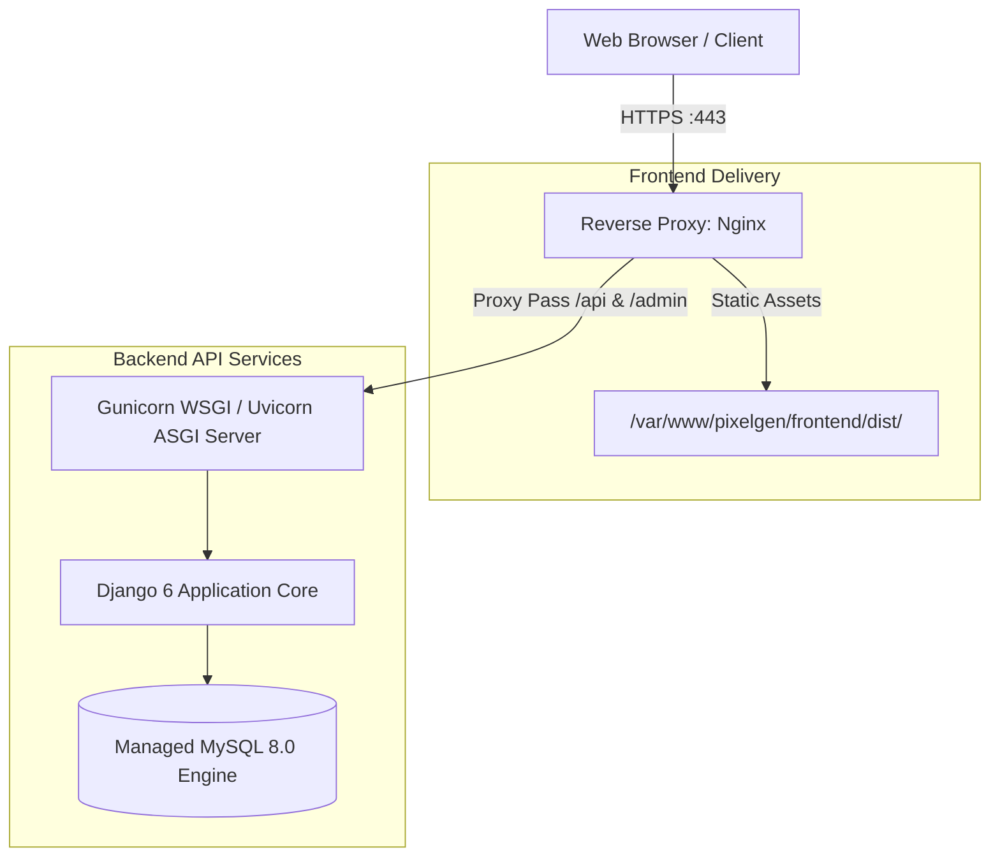

# PixelGenCreativity — Production Deployment Guide

## 1. Overview

This guide provides operational runbooks for packaging, configuring, and deploying PixelGenCreativity to production hosting environments (e.g. Linux VPS, Docker containers, Cloud VMs, or Kubernetes).

---

## 2. Production Architecture Topology



---

## 3. Backend Deployment Steps

### 3.1 Install Production WSGI Server
Inside `backend/venv`:
```bash
pip install gunicorn uvicorn
```

### 3.2 Production Environment Variables (`backend/.env`)
```ini
DJANGO_SECRET_KEY=generate-a-strong-random-50-char-key-here
DEBUG=False
ALLOWED_HOSTS=api.yourdomain.com,yourdomain.com

# CORS Configuration
CORS_ALLOWED_ORIGINS=https://yourdomain.com

# Production Database (MySQL 8.0)
DB_ENGINE=mysql
DB_NAME=pixelgencreativity_db
DB_USER=pixelgen_admin
DB_PASSWORD=strong_production_db_password
DB_HOST=mysql-db.internal.cloud.com
DB_PORT=3306

# Security Settings
SECURE_SSL_REDIRECT=True
SESSION_COOKIE_SECURE=True
CSRF_COOKIE_SECURE=True
```

### 3.3 Collect Static Files
```bash
python manage.py collectstatic --noinput
```

### 3.4 Execute Database Migrations
```bash
python manage.py migrate
```

### 3.5 Systemd Service Configuration (`/etc/systemd/system/pixelgen-backend.service`)
```ini
[Unit]
Description=PixelGenCreativity Django Backend Service
After=network.target

[Service]
User=www-data
Group=www-data
WorkingDirectory=/var/www/pixelgen/backend
ExecStart=/var/www/pixelgen/backend/venv/bin/gunicorn \
          --workers 4 \
          --bind 127.0.0.1:8000 \
          --access-logfile /var/log/gunicorn/access.log \
          --error-logfile /var/log/gunicorn/error.log \
          config.wsgi:application

Restart=always
RestartSec=5

[Install]
WantedBy=multi-user.target
```

---

## 4. Frontend Deployment Steps

### 4.1 Build Production Assets
Configure `frontend/.env`:
```ini
VITE_API_URL=https://api.yourdomain.com/api
```

Run build:
```bash
cd frontend
npm ci
npm run build
```
This generates the optimized single-page bundle in `frontend/dist/`.

---

## 5. Nginx Reverse Proxy Configuration

Create `/etc/nginx/sites-available/pixelgen.conf`:

```nginx
server {
    listen 80;
    server_name yourdomain.com api.yourdomain.com;
    return 301 https://$host$request_uri;
}

server {
    listen 443 ssl http2;
    server_name yourdomain.com;

    ssl_certificate /etc/letsencrypt/live/yourdomain.com/fullchain.pem;
    ssl_certificate_key /etc/letsencrypt/live/yourdomain.com/privkey.pem;

    root /var/www/pixelgen/frontend/dist;
    index index.html;

    # Frontend Single-Page App Routing
    location / {
        try_files $uri $uri/ /index.html;
    }

    # Static assets caching
    location /assets/ {
        expires 1y;
        add_header Cache-Control "public, immutable";
    }
}

server {
    listen 443 ssl http2;
    server_name api.yourdomain.com;

    ssl_certificate /etc/letsencrypt/live/yourdomain.com/fullchain.pem;
    ssl_certificate_key /etc/letsencrypt/live/yourdomain.com/privkey.pem;

    # Django API & Admin Proxy
    location / {
        proxy_pass http://127.0.0.1:8000;
        proxy_set_header Host $host;
        proxy_set_header X-Real-IP $remote_addr;
        proxy_set_header X-Forwarded-For $proxy_add_x_forwarded_for;
        proxy_set_header X-Forwarded-Proto $scheme;
    }

    # Django Static Files
    location /static/ {
        alias /var/www/pixelgen/backend/staticfiles/;
    }

    # Media uploads
    location /media/ {
        alias /var/www/pixelgen/backend/media/;
    }
}
```

---

## 6. SSL Certificate Provisioning
Issue automated Let's Encrypt certificates via Certbot:
```bash
sudo apt install certbot python3-certbot-nginx
sudo certbot --nginx -d yourdomain.com -d api.yourdomain.com
```

---

## 7. Health & Monitoring

After deployment, verify the production API health endpoint:
```bash
curl -I https://api.yourdomain.com/api/health/
```
Ensure HTTP `200 OK` is returned with status `"healthy"`.

