# PixelGenCreativity — Database Entity-Relationship Diagram (ERD)

## 1. Overview

This document provides a comprehensive structural visualization of the MySQL 8.0 relational database schema powering **PixelGenCreativity** as of **Phase 4: Complete Backend, MySQL Database Architecture & REST API Integration**.

All domain models are normalized, enforce relational integrity through strict foreign keys (`ON DELETE CASCADE` or `PROTECT`), include database-level indexes on search fields (`slug`, `category_id`, `session_key`, `created_at`), and are populated via idempotent Django commands.

---

## 2. Global Entity-Relationship Diagram (Mermaid)

```mermaid
erDiagram
    %% Category Domain
    Category ||--o{ SubCategory : "has child"
    Category ||--o{ Product : "categorizes"
    SubCategory ||--o{ Product : "subcategorizes"

    %% Product Core Domain
    Product ||--o{ ProductImage : "contains"
    Product ||--o{ ProductFile : "distributes"
    Product ||--o{ ProductVariant : "offers"
    Product ||--o{ ProductAttributeValue : "has value"
    ProductAttribute ||--o{ ProductAttributeValue : "defines"

    %% Tagging Domain (M2M)
    Product ||--o{ ProductTag : "tagged with"
    Tag ||--o{ ProductTag : "applies to"

    %% Curated Collections (M2M)
    Collection ||--o{ CollectionProduct : "includes"
    Product ||--o{ CollectionProduct : "part of"

    %% Licensing
    License ||--o{ Product : "default license"
    License ||--o{ CartItem : "selected license"

    %% Reviews Domain
    Product ||--o{ ProductReview : "receives"
    auth_user ||--o{ ProductReview : "authors"

    %% Shopping Cart Domain
    Product ||--o{ CartItem : "item in cart"
    auth_user ||--o{ CartItem : "owns"

    %% Wishlist & Browsing History
    Product ||--o{ WishlistItem : "saved in wishlist"
    auth_user ||--o{ WishlistItem : "saves"
    Product ||--o{ RecentlyViewed : "viewed asset"
    auth_user ||--o{ RecentlyViewed : "tracks"

    %% Promotions Domain
    Category ||--o{ Banner : "links to"
    Product ||--o{ Banner : "highlights"

    %% Table Structures
    Category {
        bigint id PK
        varchar(100) name "UNIQUE"
        varchar(120) slug "UNIQUE, INDEX"
        text description
        varchar(100) icon_name
        varchar(255) image_url
        int display_order
        boolean is_active
        datetime created_at
        datetime updated_at
    }

    SubCategory {
        bigint id PK
        bigint category_id FK
        varchar(100) name
        varchar(120) slug "UNIQUE, INDEX"
        text description
        boolean is_active
        datetime created_at
        datetime updated_at
    }

    Product {
        bigint id PK
        varchar(200) title
        varchar(255) slug "UNIQUE, INDEX"
        text short_description
        longtext description
        bigint category_id FK
        bigint subcategory_id FK "NULL"
        decimal(10_2) price "INDEX"
        decimal(10_2) original_price "NULL"
        int discount_percentage
        decimal(3_2) rating "INDEX"
        int review_count
        int sales_count "INDEX"
        int view_count
        varchar(50) status
        boolean is_featured "INDEX"
        boolean is_trending "INDEX"
        boolean is_best_seller "INDEX"
        boolean is_new "INDEX"
        boolean is_on_sale
        json compatible_software
        json file_formats
        varchar(100) dimensions
        varchar(50) resolution
        varchar(50) color_space
        boolean layered
        boolean vector_based
        bigint default_license_id FK "NULL"
        datetime created_at "INDEX"
        datetime updated_at
    }

    ProductImage {
        bigint id PK
        bigint product_id FK
        varchar(500) image_url
        varchar(200) alt_text
        int display_order
        boolean is_primary
        datetime created_at
    }

    ProductFile {
        bigint id PK
        bigint product_id FK
        varchar(50) file_format
        varchar(100) file_size
        varchar(500) download_url
        varchar(20) version
        datetime updated_at
    }

    Tag {
        bigint id PK
        varchar(60) name "UNIQUE"
        varchar(80) slug "UNIQUE, INDEX"
        datetime created_at
    }

    ProductTag {
        bigint id PK
        bigint product_id FK
        bigint tag_id FK
    }

    License {
        bigint id PK
        varchar(60) license_type "UNIQUE"
        varchar(100) name
        decimal(4_2) price_multiplier
        text description
        json terms
        boolean is_default
    }

    ProductAttribute {
        bigint id PK
        varchar(100) name
        varchar(100) slug "UNIQUE"
        varchar(30) attribute_type
    }

    ProductAttributeValue {
        bigint id PK
        bigint product_id FK
        bigint attribute_id FK
        varchar(255) value
    }

    Collection {
        bigint id PK
        varchar(150) title
        varchar(180) slug "UNIQUE, INDEX"
        text description
        varchar(255) banner_image
        boolean is_featured
        boolean is_active
        datetime created_at
    }

    CollectionProduct {
        bigint id PK
        bigint collection_id FK
        bigint product_id FK
        int display_order
    }

    ProductReview {
        bigint id PK
        bigint product_id FK
        bigint user_id FK "NULL"
        varchar(150) guest_name
        varchar(254) guest_email
        int rating
        varchar(200) title
        text comment
        boolean is_verified_purchase
        int helpful_count
        boolean is_approved "INDEX"
        datetime created_at
        datetime updated_at
    }

    CartItem {
        bigint id PK
        bigint user_id FK "NULL"
        varchar(64) session_key "INDEX"
        bigint product_id FK
        bigint license_id FK "NULL"
        int quantity
        decimal(10_2) unit_price
        datetime created_at
        datetime updated_at
    }

    WishlistItem {
        bigint id PK
        bigint user_id FK "NULL"
        varchar(64) session_key "INDEX"
        bigint product_id FK
        datetime created_at
    }

    RecentlyViewed {
        bigint id PK
        bigint user_id FK "NULL"
        varchar(64) session_key "INDEX"
        bigint product_id FK
        datetime viewed_at "INDEX"
    }

    Banner {
        bigint id PK
        varchar(150) title
        varchar(255) subtitle
        varchar(500) image_url
        varchar(255) target_url
        bigint category_id FK "NULL"
        bigint product_id FK "NULL"
        varchar(50) placement
        int display_order
        boolean is_active
        datetime start_date "NULL"
        datetime end_date "NULL"
        datetime created_at
    }

    Coupon {
        bigint id PK
        varchar(50) code "UNIQUE, INDEX"
        varchar(20) discount_type
        decimal(10_2) discount_value
        decimal(10_2) min_order_value
        decimal(10_2) max_discount_amount "NULL"
        datetime valid_from
        datetime valid_until
        int usage_limit "NULL"
        int usage_count
        boolean is_active
        datetime created_at
    }
```

---

## 3. Relational Domain Breakdowns

### 3.1 Category & Hierarchy Subsystem
- **`categories_category`**: Top-level 15 digital graphic categories.
- **`categories_subcategory`**: Finer subcategory segmentation linked via foreign key with `CASCADE` deletion.

### 3.2 Product Catalog & Media Subsystem
- **`products_product`**: Core product table containing operational metadata, pricing, software compatibility JSON, rating counters, and denormalized aggregates (`review_count`, `sales_count`).
- **`products_productimage`**: 1-to-N preview images supporting primary thumbnail flags and sorting orders.
- **`products_productfile`**: Digital asset delivery specifications (formats, byte sizes, package download URLs).
- **`products_tag` & `products_producttag`**: Normalized M2M relationship with unique constraint on `(product_id, tag_id)`.
- **`products_license`**: Standard (1.0x) and Extended Commercial (2.5x) licensing terms.
- **`products_collection` & `products_collectionproduct`**: Editorial collections ("Featured Designers", "Trending Kits").

### 3.3 Customer Interaction & Engagement Subsystem
- **`reviews_productreview`**: Reviews with star ratings (1-5), verified purchase indicators, helpful vote counters, and approval moderation status.
- **`cart_cartitem`**: Dual-identity shopping cart items. Works with both authenticated `user_id` and guest `session_key` (`X-Session-Key` header).
- **`wishlist_wishlistitem`**: Dual-identity wishlist items with unique constraint on `(session_key, product_id)` or `(user_id, product_id)`.
- **`wishlist_recentlyviewed`**: Recency-sorted user exploration history.

### 3.4 Promotions & Commercial Subsystem
- **`promotions_banner`**: Hero, category, and marketplace promotional display strips.
- **`promotions_coupon`**: Percentage and fixed discount rules with expiration validation and minimum cart requirements.

---

## 4. Referential Integrity & Deletion Rules

| Parent Model | Child Model | Foreign Key Attribute | On Delete Action | Justification |
| :--- | :--- | :--- | :--- | :--- |
| `Category` | `SubCategory` | `category` | `CASCADE` | Subcategories cannot exist without their parent category. |
| `Category` | `Product` | `category` | `PROTECT` | Prevents accidental deletion of categories containing active products. |
| `Product` | `ProductImage` | `product` | `CASCADE` | Product images belong to the product entity. |
| `Product` | `ProductFile` | `product` | `CASCADE` | Digital deliverable files belong to the product entity. |
| `Product` | `ProductTag` | `product` | `CASCADE` | Junction table entries are dropped when product is removed. |
| `Tag` | `ProductTag` | `tag` | `CASCADE` | Junction table entries are dropped when tag is removed. |
| `Product` | `ProductReview` | `product` | `CASCADE` | Reviews are scoped strictly to the target product. |
| `Product` | `CartItem` | `product` | `CASCADE` | Stale cart references are purged if a product is removed. |
| `Product` | `WishlistItem` | `product` | `CASCADE` | Wishlist items are cleared if a product is removed. |
| `License` | `CartItem` | `license` | `PROTECT` | Prevents removing license tier actively referenced by open carts. |
